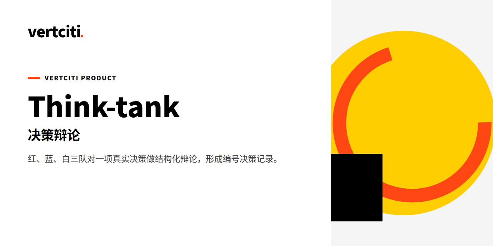

# think-tank · 智囊团

[](LICENSE)
[](SKILL.md)

**Stop deciding in your head. Put a real pending decision through a structured red/blue/white-team debate — and walk out with a D-numbered decision record you can actually defend.**

[官网](https://vertciti.com) · [快速开始](#快速开始) · [它做什么](#它做什么) · [诚实约定](#诚实约定) · [测试实证](#测试实证) · [Demo](#demo) · [FAQ](#faq)

> think-tank 是 vertciti 为创始人自用的技能工具。状态：🟡 建设中（数据截至 2026-10-21）。

Most AI "advice" is one polite voice agreeing with you. think-tank is a [Vertciti Skill Pack](https://vertciti.com) that runs a genuine multi-round dialectic on a real decision: three teams with opposing mandates plus an outside perspective, compressed arguments, a coordinator's ruling, and a CEO verdict — archived as a numbered decision record.

Built for [Miao](https://vertciti.com) (Jiahui Miao) — N=1 founder IP infrastructure.

## 快速开始
```bash
cd demo
python3 run.py --topic "Your decision here"
# Draft lands in demo/output/decision-draft.md
```

See `demo/README.md` for the minimal runnable slice.

## 它做什么

### The real problem it solves
Big decisions made solo collapse into the founder's first instinct. Think-tank forces the decision through adversarial structure: every perspective must attack and defend, every argument gets one-line compression so fluff can't hide, and a weak proposition can be killed by the fatal-flaw pre-check before it wastes a debate.

### What it delivers
Feed it **a real pending decision** (not an abstract topic, not an exercise) plus background material. One run produces, in order:

1. `Opening definition` — The decidable proposition, defined terms, three verdict options (accept / revise / reject).
2. `Tension network` — Perspective roster (red / blue / white teams + outside view) with stated positions.
3. `Dialectic` — ≥2 rounds: per-perspective arguments + one-line compression + host's core dispute + ASCII framework diagram + next-level question.
4. `Coordinator's ruling` — McKinsey-pyramid verdict: conclusion, consensus, real disagreements with rulings, red-team rebuttals, numbers, open items.
5. `CEO verdict & decision record` — D-numbered archive (background / positions / recommendation / verdict / basis / review triggers).

A fatal-flaw pre-check can short-circuit weak propositions before debate begins — no ceremony for bad ideas.

### When to use it
| Scenario | What it produces |
|---|---|
| "Do we adopt this mechanism/route/investment?" | accept / revise / reject verdict with recorded basis |
| Roadmap tradeoff (A vs B, both wanted) | structured arguments + one-line compressions, no hand-waving |
| Cross-domain dispute between teams | tension network making each position's logic explicit |
| Killing a weak proposal early | fatal-flaw pre-check, no ceremony |

### How it runs (structure, not decoration)
```
Input: decision statement + background material
  ↓  Gate 0 — single-theme screen (must serve the operating theme)
  ↓  Fatal-flaw pre-check (weak propositions killed here)
  ↓  Opening definition → Tension network
  ↓  Dialectic rounds (≥2, each with ASCII framework diagram)
  ↓  Coordinator's ruling (McKinsey pyramid)
  ↓  CEO verdict → D-numbered decision record
```

### Repo layout
```
think-tank/
  SKILL.md      # the skill itself: full debate protocol, input/output contracts
  demo/         # 30-second runnable slice → demo/output/decision-draft.md
  references/   # think-tank charter (red/blue/white teams, McKinsey method)
  evals/        # smoke evaluation with a real dry-run record
``` The demo output includes a complete worked example (`demo/output/decision-draft.md`) and a self-test record in `evals/smoke-01.md`.

## Demo
A complete worked run ships in the repo:

- `demo/output/decision-draft.md` — full debate record from a real dry-run (opening definition → dialectic with ASCII framework diagrams → coordinator's ruling → CEO verdict)
- `evals/smoke-01.md` — self-test record: the executor runs the whole five-section pipeline on a genuine pending matter ("trust-rule 式 lasting allow 机制是否排进开发计划"), pass/fail graded against the criteria

> Full run-through recording/screenshot: 待补（占位）——a step-by-step run transcript is planned; the worked output files above are already real and runnable.

状态：⚪ 计划中 — Full run-through recording/screenshot（见上行占位说明）。

## Governance
- **D15**: The chairman's word is advisory — sound advice executes, unsound advice is rejected on the record.
- **Gate 0**: Every matter must pass the single-theme screen (operating Miao's life) before debate.
- Not for P0 emergencies (execute first, record within 24h).

## Roadmap
- Dry-run harness for full debate runs with transcript capture (planned, see `evals/`).
- Decision-record archive indexing (search across D-numbers by topic/verdict).
- D148 clean-room doctrine applies to all future revisions: reimplement ideas, never copy text.

状态：⚪ 计划中 — 本节条目均为 planned。

## 诚实约定
- 每个数字标注来源与抓取时间；抓不到的标“需手动补”，绝不编数。
- Toy topics work in `demo/`, but the skill's contract is explicit: real pending decisions only in production. Abstract exercises get no verdict — the whole point is that the verdict is archived and owned.
- Not for P0 emergencies (execute first, record within 24h).
- 输出为辅助结论，不构成投资、法律或税务建议。

## 测试实证
| 指标 | 数字 | 来源 · 数据截至 |
|---|---|---|
| demo eval | PASS: 决策记录草稿五节齐全 | `bash demo/eval.sh` 实跑 · 2026-10-21 |
| quickstart | Draft lands in demo/output/decision-draft.md | `python3 run.py --topic "Your decision here"`（demo/）实跑 · 2026-10-21 |
| evals/smoke-01.md | self-test record（五节流程 dry-run） | 仓内文件 `evals/smoke-01.md` · 2026-10-21 核对 |

## FAQ
**Do I need a "real" decision, or can I test with a toy topic?**
Toy topics work in `demo/`, but the skill's contract is explicit: real pending decisions only in production. Abstract exercises get no verdict — the whole point is that the verdict is archived and owned.

**Who is the "CEO verdict" for?**
The decision owner. The skill structures the debate; a human (or your operating agent) takes the final call and the D-numbered record proves what was considered.

**Why four perspectives?**
Red attacks, blue builds, white arbitrates, outside view breaks frame. Three is enough for disagreement; four is where blind spots surface.

**Can this replace urgent incident response?**
No. Not for P0 emergencies — execute first, record within 24h. Debate is for decisions that benefit from 2 hours of structure, not 2 minutes of action.

## Contributing
Issues and PRs welcome. Keep it evidence-based: claims about debate quality need a worked run in `evals/`, not adjectives.

## Credits
Debate-organization form inspired by roundtable mechanics (original framework author: 李继刚); reimplemented clean-room per D148 — ideas borrowed, no text copied. The think-tank charter (red/blue/white teams, McKinsey method) is our own.

## 关于 vertciti
vertciti 把全部资源用来运营一个人的人生：创始人苗家辉。官网 [vertciti.com](https://vertciti.com) · 仿冒预警：vertciti 从未发行任何代币。

**Jiahui Miao** — Founder, [vertciti](https://vertciti.com). Building N=1 personal AI infrastructure. Participates in 3GPP working on 6G core network standards.

## 许可证
| Module | License | Plain meaning |
|---|---|---|
| All files | MIT | Commercial use OK, modify OK, attribution required |

See [LICENSE](LICENSE).

MIT · 运营主体 VERTCITY LLC
